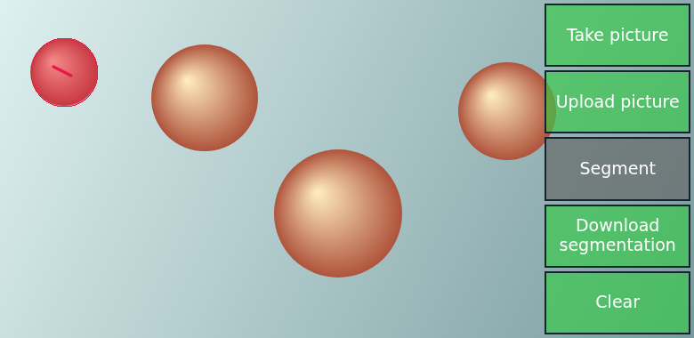

# Snap & Segment

Take a photo with your laptop or phone camera, annotate the objects you care about, and segment them with
[SAM 2.1](https://huggingface.co/onnx-community/sam2.1-hiera-tiny-ONNX). Everything runs in the browser
using [transformers.js](https://github.com/huggingface/transformers.js). There is no backend.



## Run

The files are static, so any static web server works:

```
npx serve .
```

Then open `http://localhost:3000`.

Browsers only allow camera access in a secure context: `localhost` or HTTPS. To use the camera on a phone,
host the folder somewhere with HTTPS, for example GitHub Pages. Without HTTPS, **Upload picture** still works.

The first start downloads the model, about 90 MB with WebGPU or 155 MB without it. The browser caches the
model, so later starts skip the download.

## Use

1. Hold your phone in landscape. Tap **Take picture** to start the camera, then tap it again to capture
   (or choose **Upload picture**). **Switch camera** is available while the camera is on.
2. Draw on each object to mark it. Points sampled along each stroke become segmentation prompts.
3. Tap **Segment**. Segmentation becomes available after the image is prepared and at least one object
   has been marked. Only new or changed objects are recomputed.
4. Tap **Download segmentation** for a label image where each pixel value is the object number.

Tap **Clear** to remove annotations and segmentation while keeping the picture. Double-tap **Clear**
to return to the start. You can also take or upload another picture to replace the current one.

## How it works

- `worker.js` loads `Sam2Model` in a Web Worker. It uses WebGPU (fp16 encoder) when available and falls back
  to WASM (fp32).
- The image encoder runs once, right after capture. Each object then needs only a fast prompt
  encoder/mask decoder pass, using box and/or point prompts.
- SAM returns three candidate masks per object. The app keeps the one with the highest predicted IoU.
